# UX-ревью «Стража инвестиций» глазами жюри

Дата: 2026-11-05. Свой экземпляр на порту 8791 с пустыми переменными Telegram и модели (демо-режим, шаблоны). Проверка шла в настоящем Chrome (headless, CDP) на ширине 1440, 1024 и 390. Снимки лежат в `docs/review/shots/`. Пройдены: первый экран, сюжет из `docs/DEMO.md` (правило, подтверждение, обвал, x20, истечение срока, сброс и плавное снижение), сценарии А–Д, 10 и 100 ботов, другой seed со случайной задержкой, `/pause` и `/resume` при живой заявке, остановка и возобновление торгов, свободные фразы в чате, клавиатура, перерисовка.

**Коротко.** Механика честная и сильная. Есть уточняющие вопросы, «Бот бывает хуже» (Г: −23 244 ₽), общий стакан (Д: 10 100 шт. хотели продать, продано 384). Но экран читается как пульт отладки, а не как продукт. Нет героя и первого шага. Ключевая кнопка демо и реакция Стража не видны одновременно. График сжимает событие в правый край. Итог — десять одинаковых ячеек без вывода. В чате на глазах у жюри дублируются сообщения.

---

## Проблемы по убыванию влияния на впечатление

### 1. Нет первого экрана с ценностью и первого шага
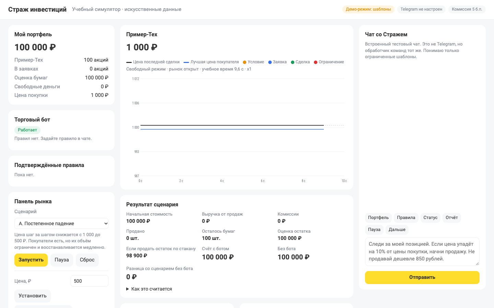

За 5 секунд видно только «Страж инвестиций», портфель, ровную линию и пустой чат. Что делает продукт, для кого он и с чего начать, не сказано. Пустое место в чате (≈450 px) выглядит как незагрузившийся блок. Плашка «Торговый бот: Работает» при «Правил нет» противоречит сама себе.

**Исправить:**
- `web/index.html`: между `header.top` и `main.grid` добавить полосу героя. Одна строка ценности: «Опишите правило словами — Страж включит торгового бота и честно покажет, что получилось бы без него». Рядом три шага-индикатора: «1 Правило в чате → 2 Подтвердить → 3 Устроить обвал», с отметками по мере прохождения (по `state.rules.length`, `state.orders.length`, `state.run.status`). И кнопка «Показать за минуту», которая вставляет пример правила и запускает сценарий Б на x10.
- `web/app.js` → `refreshChat`: если чат пуст, вывести приветственное сообщение Стража с кнопкой-примером («Следи за позицией, продай при −10%, не дешевле 850 ₽»).
- `web/app.js:38`: при `runtimes.length === 0` показывать «Ждёт правила» серым, а не «Работает» зелёным.

### 2. Сцена демо не помещается в экран, чат уезжает
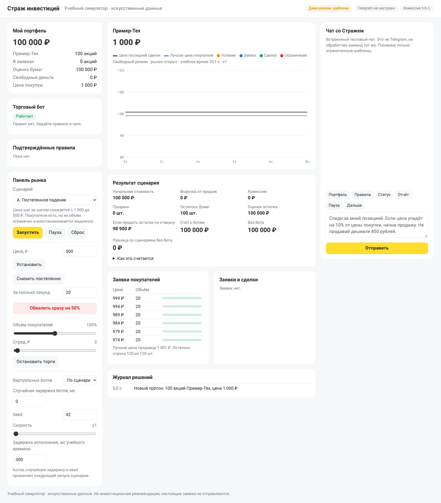 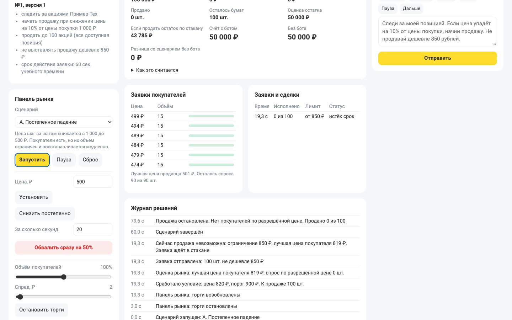 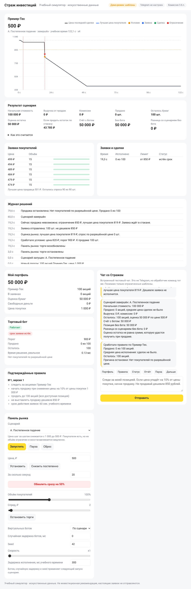 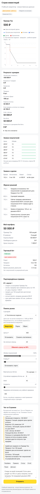

- На 1440×900 кнопка «Обвалить сразу на 50%» стоит на y≈1005 px, ниже сгиба. Сценарии, ботов и скорость ведущему тоже придётся искать прокруткой.
- `.chat-card { position: sticky }` не работает. Колонка `.col` в сетке с `align-items: start` ровно такой же высоты, как чат, поэтому при прокрутке к панели рынка чат уходит вверх. Снимок 40: чат уже срезан. Ведущий нажимает «Обвал» и не видит, что ответил Страж.
- На 1024 (типичный проектор) чат и панель рынка уезжают на ~1450 px вниз, под журнал.
- На 390 чат, главный вход в продукт, оказывается на ~4300 px из 4737.

**Исправить:**
- `web/style.css:14`: `.grid > .col:last-child { align-self: stretch; }` (тогда sticky заработает). Либо сделать колонку чата `position: sticky; top: 12px; max-height: calc(100vh - 24px)`, а `.chat` — `flex: 1`.
- `web/index.html:30-66`: разделить «Панель рынка» на два блока. «Сценарий» (выбор, Запустить, Пауза, Сброс, скорость) поднять над графиком компактной строкой. Ручки цены, спроса, ботов и seed убрать в сворачиваемый `
` «Ручки рынка» или в боковой ящик. «Обвалить» вынести на строку сценария.
- `web/style.css:79`: на ≤1180 px ставить чат сразу после графика (`order`), а портфель, правила и панель — ниже. На ≤720 px: график → чат → итог → остальное.

### 3. График не рассказывает, что произошло
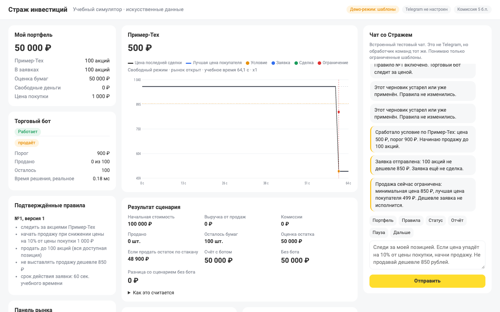 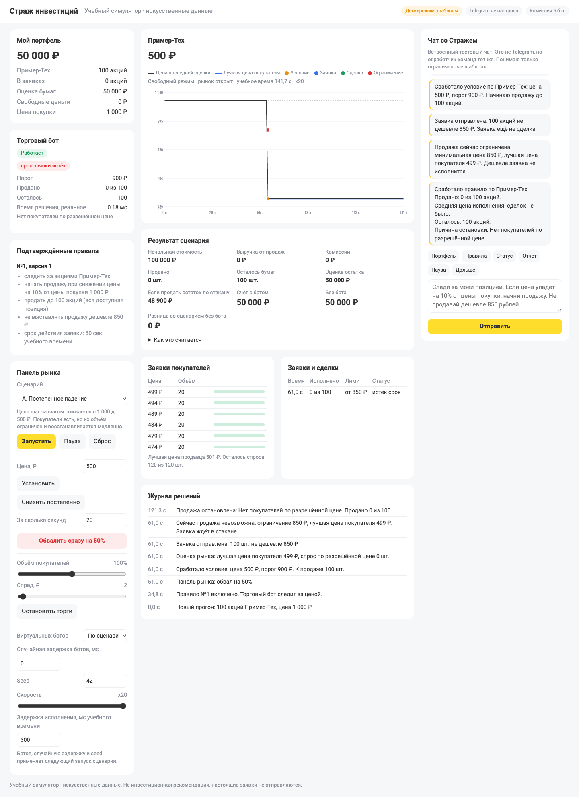 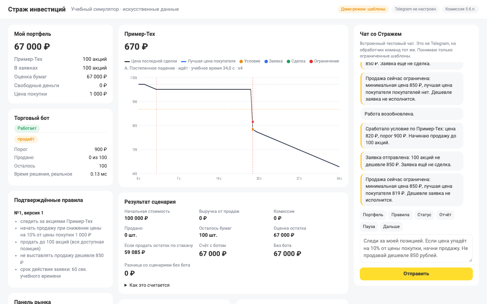 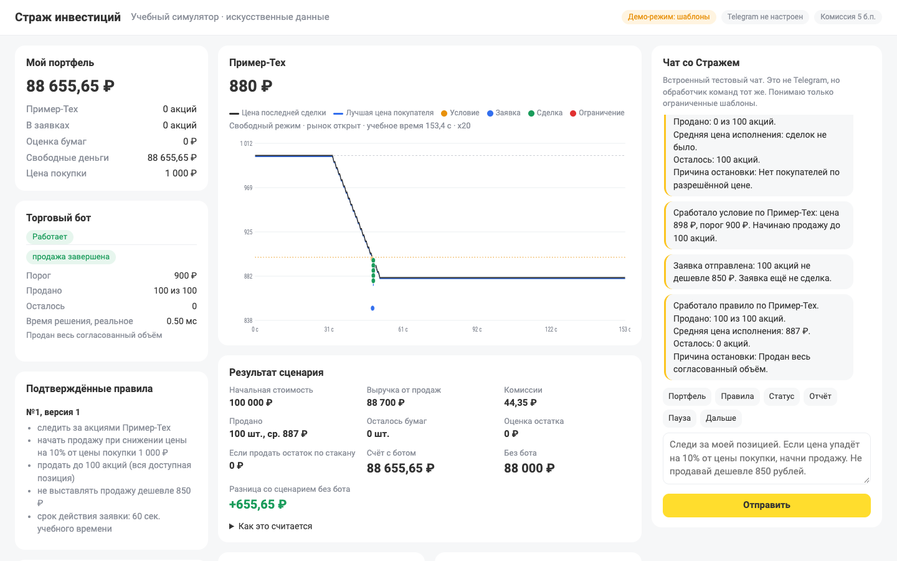 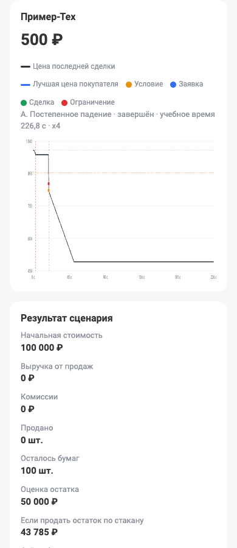

- **Часы идут всегда.** В свободном режиме учебное время тикает с загрузки, после «завершён» тоже (сценарий А на 60 с показывал 85–120 с). Обвал из шага 4 DEMO.md сжат в последние 5% оси (04b), дальше растёт плоский хвост.
- **Линия «Лучшая цена покупателя» не видна.** При спреде 2 ₽ она лежит под чёрной линией (999 под 1000, 499 под 500). А главный смысл сценария Б — разрыв между лимитом 850 и покупателем 499 — не нарисован вовсе.
- **Нет линии лимита 850 ₽** и подписей у горизонталей. Пунктиры «покупка 1000», «порог 900» и красная вертикаль ничем не подписаны.
- **Порог до события не виден.** DEMO.md шаг 3 обещает «порог 900 ₽ виден на графике», но ось берётся только из истории (987–1012), и линия 900 за кадром.
- **Деления оси Y нерегулярные:** 459/604/750/895/1040. Деление 895 стоит рядом с порогом 900 и путает. Деления оси X: 0/13/26/38/51/64 с.
- **Текст и точки искажены.** `preserveAspectRatio="none"` растягивает шрифт осей, на 390 он ≈6 px, а кружки маркеров сплющиваются в эллипсы.
- **Маркер «Заявка» висит в пустоте** на уровне лимита, под линией (06c). Маркер «Условие» закрыт зелёными точками сделок.
- **Остановка торгов** выглядит такой же красной вертикалью, как обвал. Интервал не закрашен, возобновление не отмечено, разрыв 980→820 при возобновлении не объяснён (21b).
- **Подсказки `<title>` не успевают появиться:** SVG пересобирается каждые 500 мс.

**Исправить** (`web/app.js:53-87`, `web/index.html:83`):
- `t0` брать от начала прогона или от включения правила, `t1 = min(now, end_ms + 3000)` для сценария. В свободном режиме показывать окно последних 30 с или сбрасывать часы при «Включить» и «Обвал». На сервере можно останавливать `now_ms` при `status === "finished"` (`app/sim/runner.py`).
- Добавить в диапазон оси `threshold`, `buy_price` и лимит правила. Нарисовать линию лимита красным пунктиром. Справа у каждой линии поставить подписи: «покупка 1 000», «порог 900», «не дешевле 850».
- Линию покупателя рисовать заметно: толще и под чёрной, либо закрашенной полосой «стакан» между лучшим покупателем и последней сделкой. При разрыве больше 5% подписать его: «покупатели только от 499 ₽».
- Деления ставить по «красивым» шагам 1/2/5×10ⁿ.
- Убрать `preserveAspectRatio="none"`, ширину viewBox ставить из `svg.clientWidth` (через ResizeObserver).
- Маркер заявки ставить на линию цены в момент отправки, а лимит показывать отдельной линией.
- Интервал halt→resume закрашивать серой полосой с подписью «торги остановлены».
- Перерисовывать график только при изменении `history.length` или `markers.length`.

### 4. Итог сценария без вывода
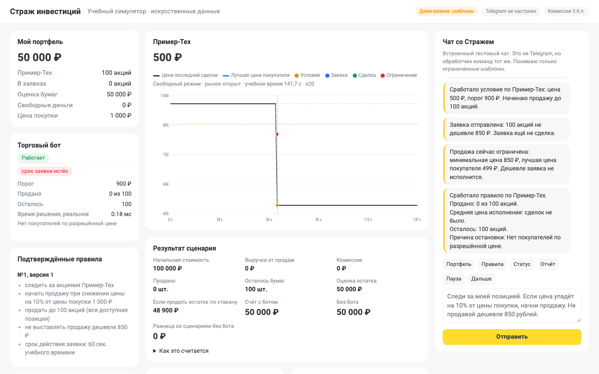 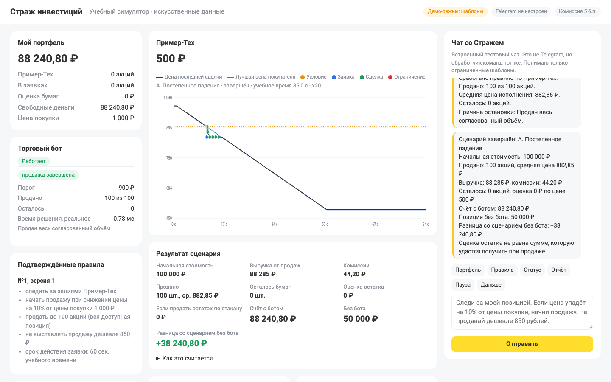 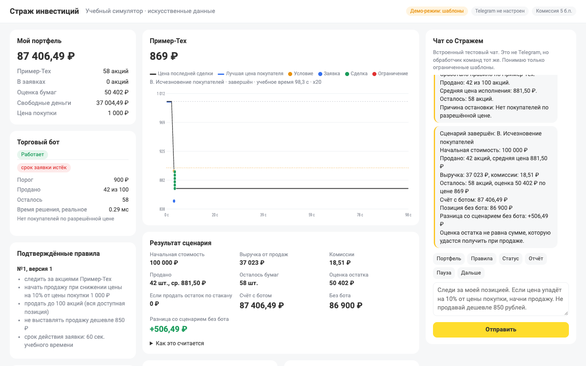

Десять ячеек одного веса. Главное («Разница со сценарием без бота») стоит последним. Нет фразы, которую жюри унесёт с собой. До любых событий блок показывает «Разница 0 ₽», «Если продать остаток по стакану 98 900 ₽» — это шум. В сценарии В «+506 ₽» стоит зелёным, хотя 58 бумаг продать некому (по стакану 0 ₽). Заголовки «Счёт с ботом» и «Без бота» в чате называются «Позиция без бота», то есть расходятся.

**Исправить:**
- `app/report.py`: добавить поле `verdict`, одну фразу по фактам. Примеры:
  - «Бот не продал ниже 850 ₽: покупатели были только от 499 ₽. Позиция цела, но подешевела вдвое.»
  - «Бот вышел по 883 ₽, без бота бумаги стоили бы 500 ₽: +38 240 ₽.»
  - «Цена вернулась: удержание было бы лучше на 23 245 ₽.»
- `web/app.js:117-125`: вверху крупно «С ботом» и «Без бота», между ними разница с цветом и вердиктом. Остальные восемь ячеек свернуть в «Подробности». Если сценарий не запущен и правило не срабатывало, показывать пустое состояние «Итог появится после срабатывания правила». При `remaining_qty > 0 && liquidation_value == 0` показывать предупреждение «58 бумаг сейчас некому продать».

### 5. Дубли сообщений в чате и «вечные» кнопки подтверждения
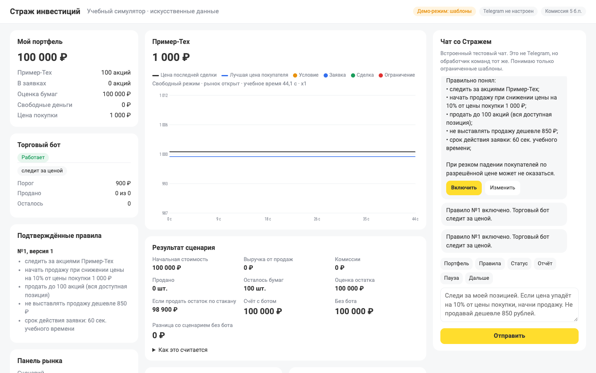

«Правило №1 включено…» в чате появилось дважды, на сервере оно одно (`/api/chat?after=0`: id 3). Причина: `tick()` из обработчика клика и `setInterval(tick, 500)` вызывают `refreshChat` одновременно с одним `lastChat`. После подтверждения кнопки «Включить» и «Изменить» остаются активными. Повторное нажатие даёт «Этот черновик устарел или уже применён», тоже дважды.

**Исправить** (`web/app.js:161-185`):
- Флаг `if (chatBusy) return;` и фильтр `rows.filter(m => m.id > lastChat)`.
- В `btn.onclick` отключать все кнопки строки: `row.querySelectorAll("button").forEach(b => b.disabled = true)`.
- Нажатую кнопку подсвечивать как «Включено ✓».

### 6. Статусы бота противоречат сами себе
 

- После включения правила: «Продано 0 из 0, Осталось 0».
- После обвала: «Работает» и «продаёт» (оранжевым), хотя продать нельзя, заявка ждёт.
- После истечения срока: «Работает» и «срок заявки истёк» (красным). Что бот делает дальше, следит ли он ещё, непонятно.
- «Время решения, реальное 0.18 мс» — с точкой, во всём остальном интерфейсе запятая.

**Исправить:** `web/app.js:37-46`. До срабатывания показывать «Ждёт падения до 900 ₽ · сейчас 1 000 ₽ (−10% осталось)», строку «Продано» скрывать. Состояние «продаёт» при `best_bid < floor` переименовать в «Ждёт покупателей от 850 ₽». После `expired` писать явно, что дальше: «Заявка снята по сроку. Правило больше не продаёт / снова следит». «мс» форматировать через `toLocaleString("ru-RU")`. Названия состояний — в `app/bot/engine.py` (`state_title`).

### 7. Ожидание без обратной связи
DEMO.md шаг 5 просит «дождаться истечения срока». Обратного отсчёта нет ни в боте, ни в таблице заявок. «Сброс» не пишет в чат ничего: новый прогон смешивается со старыми итогами, разделителей прогонов нет (06a).

**Исправить:**
- `web/app.js:109-115`: колонка «Истекает через 42 с» (`sent_at + ttl − now_ms`) и тонкая полоска прогресса у бота.
- `app/sim/runner.py`: при сбросе и старте писать в чат системную строку «— Новый прогон: А. Постепенное падение —». В `web/style.css` оформить её как разделитель `.msg.sys`.

### 8. Две разные «Паузы» и команды латиницей
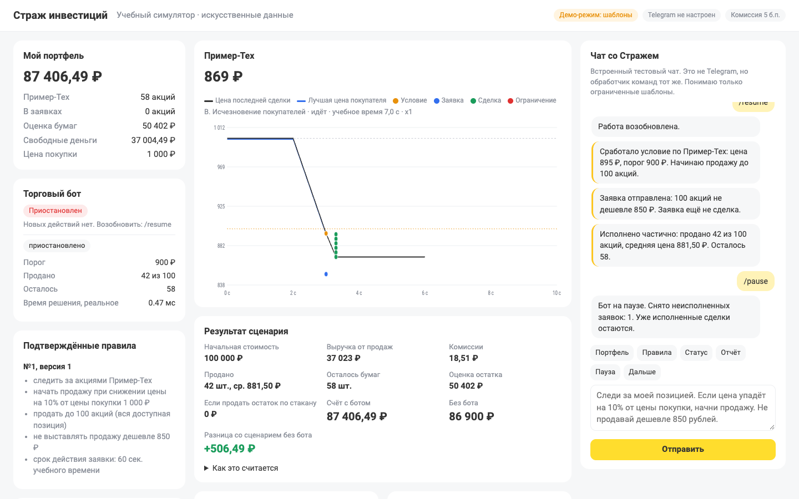

В панели рынка «Пауза» останавливает учебное время, в чате «Пауза» шлёт `/pause` боту. Пара к ней называется «Дальше». В чате пользователь видит пузыри «/pause», «/resume».

**Исправить:**
- `web/index.html:38`: «Пауза времени» / «Продолжить время».
- `web/index.html:126-127`: «Пауза бота» / «Возобновить бота».
- `web/app.js:205`: отправлять текст кнопки, а команду передавать отдельным полем, либо в `refreshChat` показывать вместо `/pause` подпись кнопки.

### 9. Сценарий Д: главный вывод спрятан
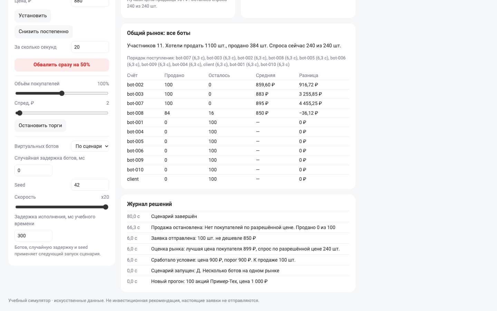 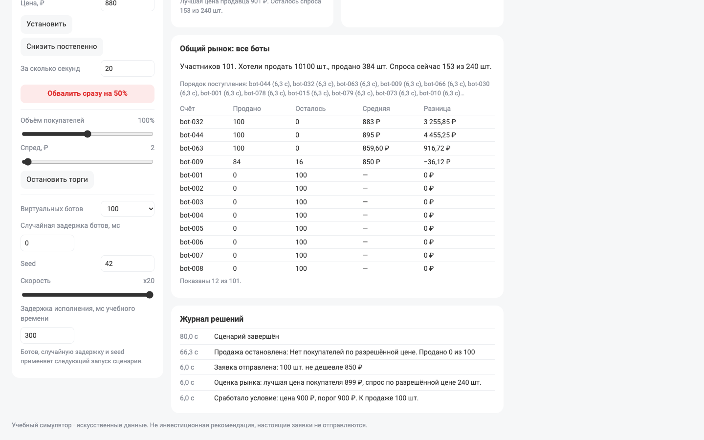 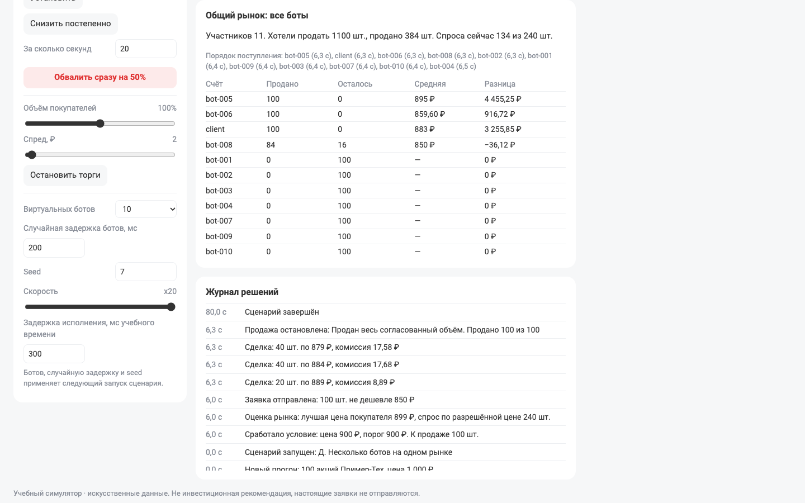

- Счета называются `bot-007` и `client` латиницей. Строка пользователя не выделена, а при 100 ботах вообще не видна (только топ-12 из 101).
- «Хотели продать 10100 шт., продано 384» дано текстом, без разделителя тысяч.
- В «Порядке поступления» у всех 6,3 с. Порядок есть, а время одинаковое, выглядит как ошибка. При задержке 200 мс видно только 6,3/6,4/6,5.
- Карточка стоит ниже стакана и заявок, на 1440 её не видно без прокрутки.

**Исправить** (`web/app.js:127-137`, имена в `app/sim/runner.py`):
- «Вы», «Бот 7». Строку «Вы» всегда показывать и подсвечивать жёлтым.
- Сверху полоса «Спрос 240 шт. ▮▯▯▯ Желающих 10 100 шт. — продано 3,8%».
- Время поступления показывать в мс относительно первого («+0 мс, +12 мс…»). При равенстве писать «одновременно, очередь по seed 42».
- При активном Д поднимать карточку сразу под график.

### 10. Остановка торгов почти незаметна
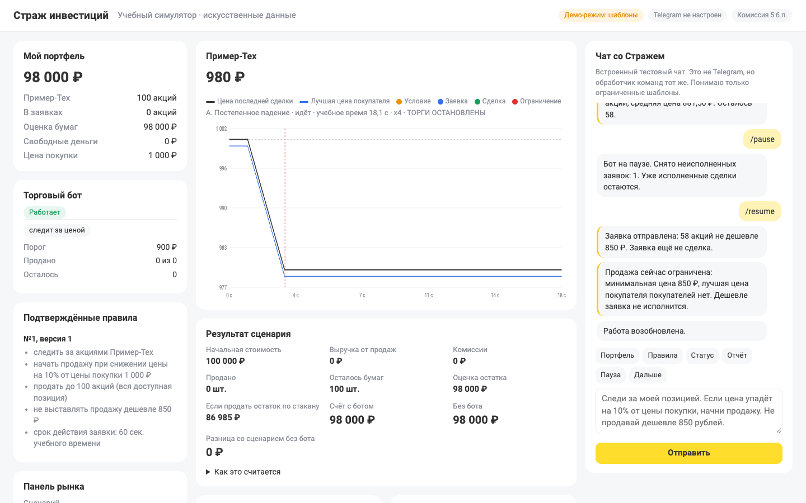

Единственный признак — серый «· ТОРГИ ОСТАНОВЛЕНЫ» в строке состояния. Страж молчит, бот «Работает · следит за ценой». После возобновления цена открывается разрывом (980 → 820 ₽ ниже лимита), и это никак не объяснено.

**Исправить:** `web/app.js:94` — красный баннер над графиком «Торги остановлены» с кнопкой «Возобновить». `app/agent/notifier.py` — уведомления «Торги по Пример-Тех остановлены, заявки не исполняются» и «Торги возобновлены, цена открылась на 820 ₽ — ниже вашего минимума 850 ₽». В карточке бота — состояние «Ждёт возобновления торгов».

### 11. Числа ломаются по строкам
 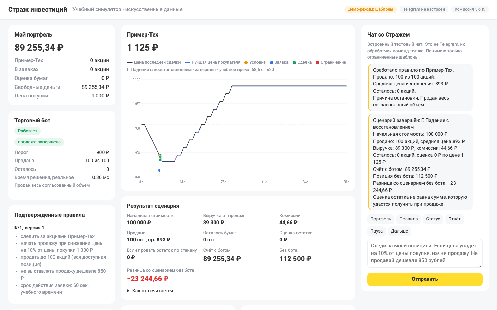

В чате видно «+38↵240,80 ₽», «882,85↵₽», «по цене 1↵125 ₽». В правилах слева — «850↵₽».

**Исправить:** `app/money.py:27-28` — разделитель групп `" "`, перед ₽ — `" "`. То же в `app/agent/texts.py`, где число стоит перед «акций», «шт.», «сек.».

### 12. Ошибки в текстах Стража
- «лучшая цена покупателя покупателей нет» — `app/agent/notifier.py:51-53`, `app/sim/runner.py:306-312`. Нужно две ветки фразы: «…покупателей сейчас нет совсем».
- «Продано: 0 акций, средняя цена сделок не было» — `app/agent/texts.py:68` и далее. При нуле писать «Сделок не было».
- «Правильно понял:» — утверждение вместо вопроса (`texts.py:50`). Лучше «Я правильно понял?», а порог назвать числом: «начать продажу, когда цена опустится до 900 ₽ (−10% от 1 000 ₽)».
- «Сработало правило… Продано: 0 из 100» (`texts.py:63`). При нуле заголовок «Правило сработало, но продать не удалось».
- «Причина остановки: Нет покупателей» — заглавная после двоеточия. Пункты списка кончаются «;», а последний пункт — «;» и пустая строка.
- Итог сценария в чате на 10 строк дублирует итог «Сработало правило…». Оставить одно короткое сообщение с вердиктом из п. 4.

### 13. Свободные фразы жюри
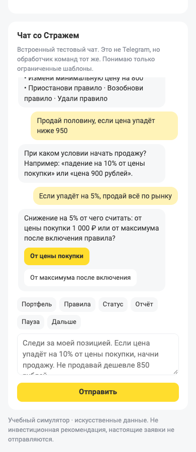

«Продай половину, если цена упадёт ниже 950» → «При каком условии начать продажу?». Жюри почти наверняка введёт свою фразу. Хорошо: уточняющий вопрос с кнопками («От цены покупки / От максимума») выглядит как продукт, это стоит показать.

**Исправить:** `app/agent/parser.py` — понимать «ниже N», «опустится до N», «меньше N». Под полем ввода показать 3 кликабельных примера-чипа вместо одного длинного placeholder.

### 14. Пример-placeholder остаётся после отправки
После «Отправить» поле очищается, но в нём снова виден тот же текст правила серым. Кажется, что сообщение не ушло (02).

**Исправить:** `web/index.html:130` — короткий placeholder «Опишите правило своими словами…», а пример перенести в чипы (п. 13). Пустой submit не подменять скрыто (`web/app.js:212`).

### 15. Настройки залипают и расходятся с сервером
- «Виртуальных ботов: 100» молча переходит на следующие сценарии. Сценарий В после Д дал пользователю 0 из 100 вместо 42 из 100: 101 участник, продавал bot-044. В строке состояния число ботов не показано.
- После перезагрузки страницы ползунок скорости показывает x1, а сервер работает на x4/x20 (30-w1024: «x4» в строке, «x1» у ползунка). `refresh()` не читает `state.run.speed`.

**Исправить:** `web/app.js:94` — дописывать в строку «· ботов 100». В `market()` синхронизировать `#speed`, `#fleet`, `#jitter`, `#seed` из state, если поле не в фокусе. Для `#fleet` лучше явная надпись «По сценарию (10)».

### 16. Шапка признаётся в недоделках
«Демо-режим: шаблоны» — оранжевым, как предупреждение. «Telegram не настроен» — первое, что видит жюри. «Комиссия 5 б.п.» — жаргон.

**Исправить:** `web/app.js:20-28`. Чипы перенести в подвал или в «i»-поповер. Если чип остаётся: «Комиссия 0,05%», «Разбор: шаблоны» нейтрально серым. Telegram показывать только когда подключён: «Уведомления в Telegram ✓».

### 17. Контраст и мелкий текст
- `--muted #8a8f99` на белом ≈3,3:1 — ниже 4,5:1 для текста 13–14 px, а на нём держатся все подписи, подсказки и журнал.
- Янтарный `#e8910c` на `#fff4e0` (чип «Демо-режим», «продаёт») ≈2,4:1.
- Ось графика 11 px, ещё и растянута.

**Исправить:** `web/style.css:2` — `--muted: #6b7079` (≈5:1). Для `.state.selling` и `.chip.warn` текст `#a55f00`. Фокус-кольцо есть (браузерное), оставить.

### 18. Перерисовка каждые 500 мс
За 3 с простоя набралось 96 мутаций DOM: все карточки пересобираются через `innerHTML`. Проверено: выделенный в журнале текст сбрасывается меньше чем за секунду, его нельзя скопировать. Подсказки на маркерах не успевают показаться. Мерцания на снимках не видно, но курсор над таблицами «прыгает».

**Исправить:** `web/app.js:143-154` — сравнивать JSON-фрагмент каждой секции с прошлым и перерисовывать только изменённые. Журнал и сделки дописывать по id.

### 19. Мелкая вёрстка панели рынка

- `select#fleet` обрезан: «По сценари».
- Поля «Случайная задержка ботов, мс» и «Задержка исполнения, мс учебного времени» переносятся под подпись, а соседние стоят в строку — сетка рваная.
- «Обвалить сразу на 50%» — процент фиксирован, хотя это ручка рынка.
- В «Заявках покупателей» нет итога «всего 120 шт. на 29 400 ₽».

**Исправить:** `web/style.css:29-30` — у `.field` подпись слева с `flex: 1`, поле фиксированной ширины 96 px, длинные подписи сократить («Разброс задержки, мс», «Задержка биржи, мс»). Для обвала добавить выбор 10/30/50%.

### 20. Журнал и чат идут в разные стороны, журнал зашумлён
В журнале новые записи сверху, в чате — снизу. В сценарии А журнал засыпан строками «Сделка: 1 шт. по 850 ₽» (десяток), а важные строки «Сработало условие» и «Оценка рынка» уезжают вниз.

**Исправить:** `web/app.js:139-141` — схлопывать подряд идущие сделки одной цены в «10 сделок по 850 ₽, всего 10 шт.» и выделять жирным строки решений (условие, отказ, остановка).

### 21. Портфель без динамики
«50 000 ₽» крупно — без «−50 000 ₽ · −50%» красным, как принято в инвест-приложениях. На мобильном портфель уезжает ниже журнала.

**Исправить:** `web/app.js:30-35` — строка изменения под `#pf-total` относительно начальной стоимости.

---

## Соответствие требованиям

| Требование | Оценка |
|---|---|
| Стиль Т-Инвестиций: светлый фон, белые карточки, жёлтые кнопки | Да. Скругления, отступы, жёлтый CTA узнаваемы. |
| Без логотипа и имитации банка | Да. Бренд «Страж инвестиций», бумага «Пример-Тех», нет знаков банка. |
| Постоянная подпись «Учебный симулятор · искусственные данные» | Частично. Есть в шапке и в подвале, но шапка не липкая: при прокрутке к панели рынка и журналу подписи на экране нет. Сделать `.top { position: sticky; top: 0; z-index: 2 }` (`web/style.css:7`), на мобильном оставить бейдж в одну строку. |
| Панель рынка со всеми ручками | Да по составу: сценарий, цена, плавное снижение, обвал, объём покупателей, спред, остановка торгов, число ботов, разброс задержки, seed, скорость, задержка исполнения. Минусы: обвал только 50%, нет пояснений к «Спред» и «Задержка исполнения», панель внизу (п. 2, 19). |

---

## Предложение по первому экрану

1. **Липкая шапка:** «Страж инвестиций» · бейдж «Учебный симулятор · искусственные данные». Справа одна иконка «i» со статусами (модель, Telegram, комиссия).
2. **Полоса героя** высотой ≤120 px. Заголовок «Правило словами — бот исполняет — честный итог». Под ним три шага с прогрессом и жёлтая кнопка «Показать за минуту». Полоса сворачивается после первого правила.
3. **Сетка 1440:** слева узкая колонка (портфель с дельтой, бот одной карточкой с правилом). В центре строка сценария (выбор, ▶, x скорость, «Обвал») и под ней график на всю ширину с подписанными линиями. Ниже карточка «Итог»: две цифры и вердикт. Справа липкий чат на всю высоту с приветствием и тремя чипами-примерами. Стакан, заявки, журнал и «Ручки рынка» — во вкладках под итогом.
4. **Пустые состояния:** на графике до правила — подпись «Цена стоит. Задайте правило в чате →». Итог: «появится после срабатывания правила». Бот: «Ждёт правила».
5. **«Вау»-деталь:** после итога в карточке короткая анимация двух линий «с ботом / без бота» на одном мини-графике и закрашенная разница (зелёная или красная). Этот кадр жюри запомнит.

## Предложение по 3-минутному показу

Подготовка до выхода: свежая БД, «Виртуальных ботов: По сценарию», скорость x10, страница перезагружена, окно 1440×900 или проектор с масштабом 90%. Чат исправлен (п. 5), иначе дубли видны в первые 30 секунд.

| Время | Что делать | Что сказать |
|---|---|---|
| 0:00–0:15 | Первый экран | «Инвестор пишет правило словами. Страж переводит его в алгоритм, бот торгует на искусственном рынке, а итог сравнивается с бездействием — честно, включая минусы.» |
| 0:15–0:45 | Ввести «Если упадёт на 10%, продай всё, не дешевле 850» → показать уточняющий вопрос или разбор → «Включить» | «Модель не торгует: она только понимает. Торгует детерминированный бот, и правило подтверждает человек.» |
| 0:45–1:15 | Сценарий **Б**, ▶ (на x10 ≈7 с). Показать на графике разрыв 850 / 499 и вердикт | «Обвал на 50%. Бот не продал по 499 — вы сами запретили дешевле 850. Мы не рисуем сделку, которой не могло быть.» |
| 1:15–1:40 | Сценарий **А**, ▶ | «Плавное падение: бот вышел по 883, без бота — 500. Плюс 38 тысяч.» |
| 1:40–2:05 | Сценарий **Г**, ▶ | «А здесь цена вернулась: бот хуже удержания на 23 тысячи. Мы это показываем.» |
| 2:05–2:35 | Сценарий **Д**, ботов 100, ▶. Указать на «Вы» в таблице и полосу спроса | «Сто одинаковых ботов, один стакан: хотели продать 10 100, рынок принял 384. Робот не спасает всех — спрос один на всех.» |
| 2:35–2:50 | «Пауза бота» в чате при живой заявке (сценарий В) | «Одна команда снимает заявки, сделки остаются.» |
| 2:50–3:00 | Итог | «Правило словами, исполнение без иллюзий, итог с честным сравнением.» |

Свободный режим из DEMO.md (обвал кнопкой и ожидание 60 с на x20) на показе лучше не использовать, пока не исправлен п. 3. Часы идут с загрузки страницы, и обвал оказывается в правом краю графика. Сценарий Б показывает то же самое за 4 секунды и с чистой осью.
